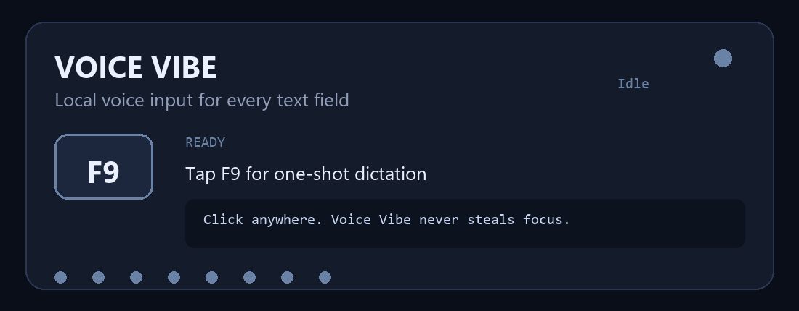
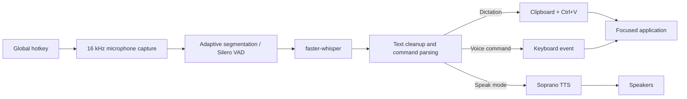

<div align="center">

# 🎙️ Voice Vibe

### Speak anywhere. Type nowhere.

**Private, local-first voice dictation for Windows — with global hotkeys, wake-word sessions, voice commands, and optional text-to-speech.**

[](https://www.python.org/)
[](#requirements)
[](https://github.com/SYSTRAN/faster-whisper)
[](#privacy)
[](https://github.com/Masqiller/Voice_Vibe)



[Quick start](#quick-start) · [How to use](#how-to-use) · [Wake-word mode](#wake-word-session) · [Configuration](#configuration-reference) · [Troubleshooting](#troubleshooting)

</div>

---

Voice Vibe turns your microphone into a system-wide input method. Click any text field—an AI chat, browser, code editor, terminal, Notepad, or search box—then speak. Transcription runs locally through Whisper and the result appears at the focused cursor.

There are three separate modes:

- **Ctrl+Alt+Space ? plain dictation:** tap to record, tap again to transcribe and paste. Basic punctuation and capitalization apply. App actions, wake matching, spoken edits, and list formatting do not run here. A separate **press enter** utterance sends Enter; `output.raw_dictation = true` makes it literal too.
- **Ctrl+Alt+W ? voice control:** arm the session, say **hey computer**, then start commands with **computer**: `computer open notepad`, `computer scroll down`, `computer what's on my screen`. Ordinary utterances remain dictation. Say `press enter` separately to submit and re-arm.
- **Ctrl+Alt+Shift+Space ? speech output:** record, transcribe, and read the transcript aloud using optional Soprano TTS.

The checked-in config enables session control and assistant replies. A configuration built from code defaults keeps these opt-in. Session edits use `control.spoken_edits`; session list formatting uses `control.format_lists`. The old `output.spoken_edits` option no longer enables edits in plain dictation.

Armed sessions keep the microphone open locally. With the default Whisper wake engine, background utterances may be decoded to detect the wake phrase. Unmatched speech is not inserted or saved to turn history. `wake.log_ignored` controls whether it is printed to the local log.

## Why Voice Vibe?

- 🪶 Runs on low-spec laptops: no GPU needed, model picked to match your hardware
- 🔒 No API key, cloud transcription, account, telemetry, or subscription
- 🎯 Inserts into the currently focused field instead of a dedicated editor
- 👻 Runs in the background with no console window — just a floating orb and a tray icon
- 💬 Replies out loud: confirms what it did, and answers questions about your screen
- 🚀 Opens your apps by voice, from a strict allowlist
- 🗣️ Wake phrase, sleep phrase, submit commands, and hands-free sessions
- ⌨️ 20 built-in voice commands (`enter`, `save it`, `undo that`, …), all configurable
- 📋 Unicode-safe clipboard paste with automatic clipboard restoration
- 📜 Every turn logged as a chat history you can read back
- 🛠️ Built-in microphone, environment, pipeline, and wake-phrase diagnostics
## Contents

- [Quick start](#quick-start)
- [How to use](#how-to-use)
- [One-shot dictation](#one-shot-dictation)
- [Wake-word session](#wake-word-session)
- [Text-to-speech](#text-to-speech)
- [Voice commands](#voice-commands)
- [Replies](#replies)
- [Chat history](#chat-history)
- [How it works](#how-it-works)
- [Configuration reference](#configuration-reference)
- [Command-line reference](#command-line-reference)
- [Testing and diagnostics](#testing-and-diagnostics)
- [Troubleshooting](#troubleshooting)
- [Privacy](#privacy)
- [Limitations](#limitations)
- [Project structure](#project-structure)

## Quick start

### Requirements

| Requirement | Details |
| --- | --- |
| Operating system | Windows 10/11 (current implementation is Windows-focused) |
| Python | 3.10, 3.11, or 3.12; Python 3.11 is recommended |
| Package manager | [`uv`](https://docs.astral.sh/uv/) recommended |
| Microphone | Any Windows input device visible to PortAudio |
| CPU | 2 cores minimum; 4+ recommended. **No GPU required.** |
| RAM | 4 GB works; the model is chosen to fit what you have |
| GPU | Optional. An NVIDIA card enables the largest model |
| Disk | ~150 MB (`tiny.en`) to ~1.6 GB (`large-v3-turbo`) of model cache |

### 1. Clone and enter the repository

```powershell
git clone https://github.com/Masqiller/Voice_Vibe.git
Set-Location Voice_Vibe
```

### 2. Create the environment

```powershell
uv venv --python 3.11
```

### 3. Install

**Standard (works on any machine, no GPU):**

```powershell
uv pip install -e .
```

**With an NVIDIA GPU:**

```powershell
uv pip install -e ".[cuda]"
```

**Optional extras:**

```powershell
uv pip install -e ".[screen]"   # exact focused-control text + Windows OCR (a few MB)
uv pip install -e ".[tts]"      # Soprano neural TTS for the speak hotkey (~3 GB, optional)
```

> [!NOTE]
> Neither extra is needed for spoken replies: those use the SAPI voice already
> built into Windows, which loads instantly and uses no extra memory.

> [!IMPORTANT]
> By default `[model].name = "auto"`, which picks a model your machine can keep
> up with — `tiny.en` on a 2-core laptop, `small.en` on 8+ cores, and
> `large-v3-turbo` only when a GPU is present. A big model that takes eight
> seconds per sentence is unusable for dictation no matter how accurate it is.
> Run `.\run.bat --check` to see what it will choose. The first run downloads
> that model once; everything after that is local.

### 4. Verify and launch

```powershell
.\run.bat --check
.\run.bat
```

A healthy check reports a microphone, `clipboard ok`, and the model it will
use. `cuda none -- CPU mode (supported)` is a normal, fully working result.

`run.bat` starts Voice Vibe **in the background**: no console window appears,
and closing windows will not stop it. Look for the floating orb in the corner of
your screen and the tray icon. To watch the log live instead, use
`.\run.bat --console`.

## How to use

| Shortcut | Mode | What it does |
| --- | --- | --- |
| `Ctrl+Alt+Space` | One-shot dictation | Tap to record, tap again to transcribe and insert |
| `Ctrl+Alt+W` | Wake-word session | Tap once to arm; say “hey computer” before each request |
| `Ctrl+Alt+Shift+Space` | Speak aloud | Tap to record, tap again to read the transcript via Soprano |
| `Ctrl+Alt+Shift+Q` | Quit | Stops Voice Vibe; the tray icon menu also works |

Always click the destination field first. Voice Vibe never steals focus: text goes to whichever window owns the keyboard focus when insertion occurs.

### Status feedback

Three channels, all showing the same state: the floating orb, the tray icon,
and short beeps.

| State | Colour | Meaning |
| --- | --- | --- |
| Idle | Grey | Ready; no active recording/session |
| Recording | Red | Dictate or speak is capturing audio |
| Armed | Slate | A session is listening for the wake phrase; nothing is typed |
| Dictating | Blue | Wake phrase accepted; speech can be inserted |
| Transcribing | Amber | Audio is being decoded/processed |

#### The orb

A small circle floats above every other window, including fullscreen apps. It
is not a window: it has no frame, cannot be moved or focused, and clicks pass
straight through it. It pulses while listening, and expands to show what was
just heard or said before shrinking back to a dot.

It is drawn as a Win32 layered window using Pillow, which is already a
dependency — so it adds no packages and costs a few megabytes of RAM.

Move it, resize it, or switch it off under `[overlay]` in `config.toml`.

#### The Airoot listening overlay

Optionally, the animated Airoot logo with its "Listening" pill appears at the
bottom centre of the screen whenever the mic is taking in speech — dictate, speak,
or a session after the wake word — and disappears when it stops. It reacts
to your voice level.

It is a separate program (`AirootVoiceOverlay.exe`). Voice Vibe starts it hidden
at launch so it appears instantly, drives it over a localhost UDP port, and
closes it on exit. It never takes keyboard focus, so dictation still lands in
your editor. Point `[airoot].exe` at it and set `enabled = true`.

> [!NOTE]
> It uses about 135 MB of RAM while running, against a few MB for the built-in
> orb. On a low-memory laptop, leave `[airoot].enabled = false`; the orb shows
> the same state.

Beeps reinforce the state changes: start, success, error, session open/close, wake, and re-arm each have distinct cues.

## One-shot dictation

The simplest workflow:

```text
1. Click a text field
2. Press Ctrl+Alt+Space   → recording begins
3. Speak naturally
4. Press it again         → recording stops
5. Whisper transcribes    → text is pasted at the cursor
```

Example:

```text
You say:   Refactor the authentication middleware and add tests
Inserted:  Refactor the authentication middleware and add tests 
```

Recordings shorter than `audio.min_duration` are ignored, preventing accidental hotkey taps from producing text.

## Wake-word session

```text
Ctrl+Alt+W                         -> armed; background speech is ignored
"hey computer"                    -> awake
"computer open notepad"           -> launch an allowlisted app
"computer scroll down"            -> scroll
"computer what's on my screen"    -> reply using UIA/OCR
"draft the meeting notes"         -> insert normal dictation
"computer scratch that"           -> erase the previous session utterance
"bullet milk bullet eggs"         -> insert a formatted list
"press enter"                     -> Enter, then re-arm
Ctrl+Alt+W                         -> close the session
```

Wake and command can share an utterance: **hey computer, computer open notepad**. The wake phrase and command prefix are separate gates. Unrecognized prefixed commands fall back to dictation with the prefix retained. Spoken edits assume the cursor is still immediately after the preceding session utterance; intervening commands clear that edit context.

### Wake phrases

Defaults:

```toml
phrases = ["hey computer", "okay computer", "ok computer"]
```

Two common words are more reliable than a short uncommon word. For example, Whisper may hear `arise` as “a rise,” “arrives,” or “Iris.” The default phrases provide more linguistic context.

Wake detection includes:

1. Exact case-insensitive word matching
2. Safe word-aligned fuzzy matching (`fuzzy = 0.82`)
3. Whisper `initial_prompt` biasing toward configured phrases
4. Support for split words and small transcription errors

It deliberately does **not** let a partial phrase match. Saying “my computer crashed” does not match “hey computer.”

### Test your own phrase

```powershell
.\run.bat --wake-test
.\run.bat --wake-test --wake "hey jarvis"
.\run.bat --wake-test --wake "start dictation" --rounds 8
```

The test records several attempts, reports exactly what Whisper heard, calculates the match rate, and suggests aliases when necessary.

Suggested phrases:

- `hey computer`
- `okay computer`
- `hey jarvis`
- `computer listen`
- `start dictation`
- `wake up`

### Sleep and safety

While dictating, say one of these to abort without submitting:

- `never mind`
- `nevermind`
- `go to sleep`
- `cancel that`

After `wake.active_timeout` seconds of inactivity, Voice Vibe automatically re-arms. This prevents a forgotten active dictation from typing a later room conversation.

## Text-to-speech

With the optional `tts` dependencies installed:

```text
Press Ctrl+Alt+Shift+Space → speak → press it again → Whisper text → Soprano audio
```

Nothing is inserted into the focused field. Soprano reads the transcript through the default speakers.

Install TTS support:

```powershell
uv pip install -e ".[cuda,tts]"
```

Test it directly:

```powershell
.\run.bat --say "Voice Vibe is ready"
```

Soprano is English-only and does not clone your voice. It uses its own generated voice. The first use downloads and loads its model; set `speech.preload = true` to pay that startup cost when Voice Vibe launches instead.
## Voice commands

Commands run only in an awake Ctrl+Alt+W session and require a leading **computer** prefix. The checked-in `[control]` configuration enables them.

| Example | Action |
| --- | --- |
| `computer save` / `computer undo` | Editing shortcuts |
| `computer scroll down` / `computer keep scrolling` | Scroll once / repeatedly |
| `stop` while scrolling | Stop the repeat, even after re-arming |
| `computer new tab` / `computer next tab` | Browser tabs |
| `computer minimize` / `computer switch to notepad` | Window control |
| `computer click Settings` / `computer show numbers` | UI Automation with OCR fallback |
| `computer click 7` | Choose a numbered target |
| `computer replace Tuesday with Wednesday` | Edit the previous session utterance |

App profiles take precedence over `[[commands]]`, then built-in global commands, then exact UIA/OCR targets. Profiles cover Explorer, Zen, Claude, and ChatGPT. Add custom profiles under `[[profiles]]` in `config.toml`.

Dangerous trigger words (including delete, uninstall, send, buy) request spoken confirmation. Only an explicit confirmation proceeds; cancellation or timeout stops the action. Lock always asks. These gates also apply to restored spoken deletion edits.

`[[commands]]` rows customize prefixed session shortcuts, for example:

```toml
[[commands]]
say = "send message"
keys = "ctrl+enter"
ends_dictation = true
```

In plain dictation, only the separate utterance **press enter** is a key command. Trailing `enter` or `send it` in a sentence stays text.

## Replies

In an awake session, prefix requests with **computer**. Voice Vibe speaks replies through the Windows voice and shows them in the overlay.

| Say | What happens |
| --- | --- |
| "open chrome", "launch blender" | Starts the app, says "Opening Chrome." |
| "what's on my screen" | Reads the window and what it can see in it |
| "what is this error" | Finds the error line and reads it out |
| "read this" | Reads your current selection |
| "where am I" | Names the app you are focused on |
| "what can you do" | Lists what it handles |

> [!IMPORTANT]
> **There is no language model here.** Answers are matched and extracted from
> what is actually on screen — never generated. That makes replies instant, means
> they cannot be invented, and costs no extra memory, which is what keeps this
> usable on a cheap laptop. Anything not recognised is treated as ordinary
> dictation, so nothing you say is ever swallowed.

Turn replies off entirely with `[assistant].enabled = false`.

### Opening apps

Start Menu shortcuts and stock Windows tools are indexed at startup, so most
apps work with no configuration. Add anything missing — or a shorthand the
matcher does not guess — under `[[apps]]`.

> [!WARNING]
> This is the only part of Voice Vibe that turns speech into running a program,
> so it is deliberately narrow. What you say only ever **selects** an entry from
> the allowlist: the transcript is never used to build a path, never passed to a
> shell, and never executed. A name that matches nothing is refused out loud
> rather than guessed at. Uninstallers, repair tools and readme links are
> excluded from the index.

### Reading the screen

Four sources, cheapest first, each falling back to the next:

| Source | Needs | Notes |
| --- | --- | --- |
| Window title | nothing | Always available |
| Selected text | nothing | Clipboard round-trip; your clipboard is restored |
| Focused control text | `[screen]` extra | Exact text, no OCR errors |
| OCR | `[screen]` extra | The recogniser built into Windows — no model download |

Without the `[screen]` extra you still get the title and your selection, which
covers the common case ("what is this error" with the error selected).

## Chat history

Because it runs in the background, the console is no longer the record of what
happened. Two files under `%LOCALAPPDATA%\VoiceVibe\` are:

- `logsoicevibe.log` — rotating diagnostic log
- `history\YYYY-MM-DD.jsonl` — one JSON object per turn: what was heard, where
  it went, what was inserted, which keys fired, and any reply

Old history is pruned after `[history].keep_days`. Set `enabled = false` to keep
nothing at all.
## How it works



### One-shot pipeline

```text
pynput global hotkey
  → sounddevice float32 mono capture
  → faster-whisper / CTranslate2
  → Silero VAD filtering
  → replacements + formatting
  → clipboard save
  → copy transcript
  → simulated Ctrl+V
  → clipboard restore
```

### Continuous session pipeline

```text
continuous 30 ms audio blocks
  → adaptive room-noise estimate
  → speech-onset detection + 350 ms pre-roll
  → pause-based utterance segmentation
  → queued local Whisper transcription
  → ARMED: wake matching only
  → DICTATING: insert text / fire commands
  → submit command: return to ARMED
```

The adaptive segmenter updates its noise floor only from quiet blocks. Speech cannot ratchet the threshold upward. Minimum duration is measured on voiced blocks rather than pre-roll or trailing silence, which filters keyboard clicks and coughs without clipping first syllables.

### Why clipboard paste?

Pasting is faster than synthesizing every character and preserves Unicode such as smart quotes, em dashes, emoji, and non-Latin scripts. Voice Vibe saves the previous clipboard text, pastes the transcript, waits briefly, and restores the original clipboard.

Set `output.mode = "type"` for an application that refuses programmatic paste.
## Configuration reference

Voice Vibe reads [`config.toml`](config.toml) at startup. Restart after changing it.

### `[hotkeys]`

| Key | Default | Description |
| --- | --- | --- |
| `dictate` | `ctrl+alt+space` | Tap-to-toggle one-shot dictation |
| `dictate_hold` | empty | Optional hold-to-record binding |
| `session` | `ctrl+alt+w` | Open/close the persistent wake-word session |
| `speak` | `ctrl+alt+shift+space` | Tap-to-toggle TTS capture |
| `speak_hold` | empty | Optional hold-to-record TTS binding |
| `quit` | `ctrl+alt+shift+q` | Quit Voice Vibe |

Hotkey syntax is lowercase tokens separated by `+`, for example `ctrl+alt+d`, `shift+f9`, or `alt_gr`. Left/right modifier variants normalize to the same token. When bindings overlap, the most specific combination wins, so `ctrl+alt+shift+space` never also fires `ctrl+alt+space`.

The defaults deliberately avoid F-keys: most laptops send brightness,
volume and media actions from the top row unless Fn is held, so an F-key
binding can silently do nothing. To see what any key or combination is
called on your keyboard, run `.\run.bat --key-test` and press it.

### `[model]`

| Key | Default | Description |
| --- | --- | --- |
| `name` | `auto` | `auto` matches your hardware; or pin any Whisper / CTranslate2 model |
| `device` | `auto` | `auto`, `cuda`, or `cpu` |
| `compute_type` | `auto` | GPU defaults to `float16`; CPU defaults to `int8` |
| `cpu_threads` | `0` | CPU inference threads. `0` leaves one core free for audio capture |
| `language` | `en` | ISO-639-1 code, or `auto` for detection |
| `beam_size` | `1` | Decoder beam width; larger may improve accuracy but adds latency |
| `vad_filter` | `true` | Apply Silero VAD before decoding |
| `initial_prompt` | empty | Bias technical vocabulary and spelling |

What `auto` chooses, and what you can pin instead:

| Hardware | Picks | Approx. size | Notes |
| --- | --- | --- | --- |
| Any NVIDIA GPU | `large-v3-turbo` | ~1.6 GB | Best accuracy, needs VRAM |
| CPU, 8+ cores | `small.en` | ~500 MB | Good accuracy, keeps up while typing |
| CPU, 4+ cores | `base.en` | ~150 MB | The practical default for budget laptops |
| CPU, 2 cores or <4 GB RAM | `tiny.en` | ~75 MB | Fastest; noticeably less accurate |

The `.en` builds are both smaller *and* more accurate than the multilingual
models of the same size for English, which is the right trade when the machine
is the constraint. Set `language` to anything other than `en` and you should pin
a multilingual model (`tiny`, `base`, `small`, `large-v3`) yourself.

`distil-small.en`, `distil-medium.en` and `distil-large-v3` are also available
as English-oriented distilled options.

### `[audio]`

| Key | Default | Description |
| --- | --- | --- |
| `sample_rate` | `16000` | Whisper-native microphone sample rate |
| `input_device` | empty | System default; use a listed device index/name to override |
| `min_duration` | `0.25` | Ignore shorter one-shot recordings |
| `max_duration` | `300.0` | Hard cap for one-shot capture |

List devices:

```powershell
.\run.bat --list-devices
```

Then set, for example:

```toml
[audio]
input_device = "5"
```

### `[continuous]`

| Key | Default | Description |
| --- | --- | --- |
| `silence_duration` | `1.5` | Quiet time that ends an utterance |
| `speech_ratio` | `4.0` | Required level above the adaptive noise floor |
| `min_rms` | `0.006` | Absolute noise gate |
| `min_segment` | `0.3` | Minimum voiced duration; filters clicks/coughs |
| `max_segment` | `60.0` | Force a segment if speech never pauses |
| `pre_roll` | `0.35` | Audio retained before onset to preserve first syllables |

Increase `silence_duration` if Voice Vibe cuts you off while thinking. Lower it for faster responses. Raise `speech_ratio` in a noisy room; lower it if quiet speech is missed.
### `[wake]`

| Key | Default | Description |
| --- | --- | --- |
| `enabled` | `true` | Require a wake phrase in session mode |
| `phrases` | hey/okay/ok computer | Accepted wake phrases |
| `fuzzy` | `0.82` | Per-word near-match threshold; `0` disables |
| `bias_prompt` | `true` | Prime Whisper with the wake phrases |
| `sleep_phrases` | several | Abort active dictation without typing |
| `active_timeout` | `20.0` | Re-arm after inactivity; `0` disables |
| `log_ignored` | `true` | Show armed-state transcripts for tuning |

Set `enabled = false` to make the session insert every segmented utterance without a wake phrase.

### `[output]`

| Key | Default | Description |
| --- | --- | --- |
| `mode` | `paste` | `paste` or simulated `type` |
| `restore_clipboard` | `true` | Restore previous clipboard text after paste |
| `restore_delay` | `0.5` | Seconds before restoring. Runs off-thread, so it never delays Enter |
| `type_delay` | `0.004` | Delay per character in type mode |
| `add_trailing_space` | `true` | Append a space after normal dictation |
| `strip_trailing_period` | `false` | Remove a final period |
| `lowercase` | `false` | Lowercase the transcript |
| `voice_commands` | `true` | Enable the separate `press enter` utterance |
| `command_delay` | `0.12` | Wait between insertion and key action |

Raise `command_delay` if a target submits before the pasted text has landed.

### `[speech]`

| Key | Default | Description |
| --- | --- | --- |
| `device` | `auto` | `auto`, `cuda`, `cpu`, or `mps` |
| `backend` | `auto` | `auto`, `transformers`, or `lmdeploy` |
| `streaming` | `true` | Play chunks as they are generated |
| `temperature` | `0.4` | Delivery variation |
| `top_p` | `0.95` | Nucleus sampling threshold |
| `repetition_penalty` | `1.2` | Discourage loops |
| `cache_size_mb` | `100` | Soprano backend cache |
| `decoder_batch_size` | `1` | Decoder batch size |
| `preload` | `false` | Load Soprano when Voice Vibe starts |
| `save_dir` | empty | Optional folder for generated WAV files |

When `save_dir` is set, generation uses the non-streaming path so the audio can be written and then played.

### `[feedback]`

| Key | Default | Description |
| --- | --- | --- |
| `sounds` | `true` | Enable audible state cues |
| `tray_icon` | `true` | Show the state indicator |
| `log_transcripts` | `true` | Include recognized text in the log |

### `[overlay]`

The floating status orb.

| Key | Default | Description |
| --- | --- | --- |
| `enabled` | `true` | Show the orb at all |
| `position` | `bottom-right` | Also `bottom-left`, `top-right`, `top-left` |
| `size` | `58` | Orb diameter in pixels |
| `margin` | `28` | Distance from the screen edge |
| `opacity` | `0.95` | 0.1 to 1.0 |
| `expand_seconds` | `4.0` | How long a caption stays up |
| `max_width` | `460` | Caption width cap in pixels |

### `[history]`

| Key | Default | Description |
| --- | --- | --- |
| `enabled` | `true` | Write the JSONL turn history |
| `keep_days` | `30` | Delete history older than this; `0` keeps everything |

### `[assistant]`

| Key | Default | Description |
| --- | --- | --- |
| `enabled` | `true` | Master switch for replies. `false` restores pure dictation |
| `launch_apps` | `true` | Handle "open X" / "launch X" |
| `answer_screen` | `true` | Handle screen questions |
| `discover_apps` | `true` | Index Start Menu shortcuts at startup |
| `match_threshold` | `0.78` | How close a spoken app name must be, 0 to 1 |
| `speak_replies` | `true` | Speak confirmations through the Windows SAPI voice |
| `voice_rate` | `1` | -10 (slowest) to 10 (fastest) |

### `[airoot]`

| Key | Default | Description |
| --- | --- | --- |
| `enabled` | `false` | Show the Airoot overlay while listening |
| `exe` | empty | Full path to `AirootVoiceOverlay.exe` |
| `port` | `53873` | UDP port compiled into the overlay |
| `preload` | `true` | Start it hidden at launch so the first show is instant |
| `quit_on_exit` | `true` | Close it on exit, if Voice Vibe started it |

### `[screen]`

| Key | Default | Description |
| --- | --- | --- |
| `enabled` | `true` | Allow reading the screen at all |
| `use_selection` | `true` | Grab the selection via a clipboard round-trip |
| `use_uia` | `true` | Read the focused control (needs the `screen` extra) |
| `use_ocr` | `true` | Windows OCR fallback (needs the `screen` extra) |
| `max_chars` | `4000` | Cap on extracted text |

### `[[apps]]`

Apps you can open by voice, beyond the auto-discovered Start Menu entries:

```toml
[[apps]]
say = "blender"
path = "C:/Program Files/Blender Foundation/Blender 4.2/blender.exe"

[[apps]]
say = "vs code"
path = "C:/Users/you/AppData/Local/Programs/Microsoft VS Code/Code.exe"
```

Optional `args = [...]` is passed as a list, never through a shell. See the
warning under [Opening apps](#opening-apps).

### `[[replacements]]`

Literal replacements run in order before insertion:

```toml
[[replacements]]
find = "new line"
replace = "\n"

[[replacements]]
find = "post grass"
replace = "Postgres"
```

Use this for spoken formatting and recurring recognition mistakes. Keep replacement phrases specific to avoid modifying normal sentences.

## Command-line reference

```text
run.bat [options]
```

| Option | Purpose |
| --- | --- |
| `-c, --config PATH` | Load a different TOML file |
| `--model NAME` | Override the Whisper model |
| `--device auto|cuda|cpu` | Override inference device |
| `--language CODE` | Override language; use `auto` to detect |
| `--mode paste|type` | Override insertion method |
| `--list-devices` | List microphone input devices |
| `--check` | Check Python, CUDA, microphone, and clipboard |
| `--mic-test` | Record with a live input meter |
| `--test` | Record, transcribe, and print without insertion |
| `--seconds N` | Recording duration for test modes |
| `--wake-test` | Measure wake phrase recognition |
| `--wake "PHRASE"` | Temporarily override wake phrases; comma-separated accepted |
| `--rounds N` | Attempts during `--wake-test` |
| `--say "TEXT"` | Synthesize text through Soprano and exit |
| `--key-test` | Show the hotkey name of each key you press |
| `-v, --verbose` | Enable debug logging |
| `--version` | Print the version and exit |
| `--console` | Keep a visible console window (handled by `run.bat`) |

Examples:

```powershell
.\run.bat --model small --device cpu
.\run.bat --language auto --mode type
.\run.bat --wake-test --wake "start dictation" --rounds 10
.\run.bat --say "Build complete"
```
## Testing and diagnostics

Run these in order; stop at the first failure.

### 1. Environment

```powershell
.\run.bat --check
```

Expected: Python version, registered CUDA DLL directories, CTranslate2 device count, microphone name, and clipboard status.

### 2. Microphone level

```powershell
.\run.bat --mic-test
```

Speak normally for five seconds. A healthy signal moves the live dB meter and finishes with `OK microphone level looks healthy`. A meter stuck around -90 to -100 dB indicates silence.

### 3. Full STT pipeline

```powershell
.\run.bat --test
```

This records, transcribes, and prints the result without inserting anything. It isolates Whisper from focus/paste problems.

### 4. Wake recognition

```powershell
.\run.bat --wake-test
```

Use this whenever changing microphones, room acoustics, models, language, or the wake phrase.

### 5. Real insertion

1. Start `run.bat`.
2. Open Notepad.
3. Click inside the document so the caret blinks.
4. Press Ctrl+Alt+Space, speak a complete sentence, and press it again.
5. Confirm the console target title says Notepad and the sentence appears there.

Then test a browser input and a terminal because applications handle simulated paste differently.

## Troubleshooting

### The transcript appears in the console but not the target

Console output is a log, not the insertion destination. The target must still own keyboard focus when insertion occurs. Look for:

```text
[0.43s] -> Untitled - Notepad | your transcript
```

If the title is the terminal, the terminal had focus. Click the desired field and try again.

### Microphone is silent

1. Open **Settings → Privacy & security → Microphone**.
2. Allow desktop apps to access the microphone.
3. Open **Sound settings → Input**, select the correct device, unmute it, and raise its level.
4. Run `--list-devices` and set `audio.input_device`.
5. Confirm with `--mic-test`.

### Wake phrase is ignored

- Run `--wake-test` and inspect what Whisper actually heard.
- Prefer two common words, such as `hey computer`, over a rare isolated word.
- Add consistent mishearings to `wake.phrases`.
- Leave `wake.bias_prompt = true`.
- Raise `wake.fuzzy` to make matching stricter; lower it cautiously.
- Speak after the session-open beep and leave a short pause afterward.

### Wake phrase fires accidentally

- Choose a less common two-word phrase.
- Raise `wake.fuzzy` toward `0.9` or set it to `0` for exact matching.
- Remove broad aliases from `wake.phrases`.
- Do not use a single everyday word such as `computer`, `start`, or `hello`.

### The session cuts sentences too early

Raise:

```toml
[continuous]
silence_duration = 2.5
```

If speech itself is missed, lower `speech_ratio` slightly. If background noise triggers segments, raise it.

### Enter submits before the paste appears

Raise:

```toml
[output]
command_delay = 0.25
```

### Enter creates a newline instead of submitting

Configure the shortcut expected by that application:

```toml
[[commands]]
say = "send message"
keys = "ctrl+enter"
```

### Paste does not work in an elevated application

Windows prevents a normal process from injecting input into an administrator-elevated application. Run Voice Vibe at the same privilege level, or avoid elevating the target.

### Dictation is slow

Check what model is loaded with `.\run.bat --check`. If `[model].name` is
pinned to something large, set it back to `"auto"`. On CPU, `tiny.en` and
`base.en` are several times faster than `small.en`, and far faster than
`large-v3-turbo`, which is not a sensible CPU choice on a budget machine.

If audio drops out mid-sentence while transcribing, lower `[model].cpu_threads`
so a core stays free for capture.

### The orb is not visible

Check `[overlay].enabled`. Some remote-desktop and screen-capture setups do not
composite layered windows; the tray icon still works, and the orb disables
itself rather than failing. Move it with `[overlay].position` if it is behind a
taskbar element.

### A hotkey does nothing

On most laptops the top row sends brightness, volume or media actions unless
you hold **Fn** — or until you turn on Fn Lock, often Fn+Esc. If you rebound a
hotkey to an F-key and it does nothing, that is why.

Run `.\run.bat --key-test` and press the key. If it shows as something like
`media_volume_up`, that is what your laptop really sends; either bind that
name, hold Fn, or pick a modifier combination instead. If nothing prints at
all, the key is handled by firmware and never reaches Windows.

Also check the focused app is not running as administrator: Windows does not
deliver key events from an elevated window to a normal one.

### The Airoot overlay does not appear

Run `.\run.bat --console -v` and look for `[airoot] is enabled but the overlay
was not found` — that means `[airoot].exe` is wrong. The path must point at the
file itself, not its folder. If another copy of the overlay is already running,
Voice Vibe uses that one rather than starting its own.

### "I don't know an app called ..."

The name did not match anything in the allowlist, and it is refused rather than
guessed at. Run with `--console -v` to see what was indexed, then add an
explicit `[[apps]]` entry with the exact path.

### CUDA is unavailable

Run `--check`. Voice Vibe registers pip-installed cuBLAS and cuDNN DLL paths before importing CTranslate2. If CUDA still reports zero devices, update the NVIDIA driver or set `model.device = "cpu"`.

### Soprano is slow on first use

The model is loaded lazily. Set `speech.preload = true` to load it during startup. Windows may install a CPU-only PyTorch build for Soprano; CPU streaming remains supported and leaves GPU memory available to Whisper.
## Privacy

Voice Vibe is local-first:

- Microphone audio is captured in memory.
- Audio is discarded after transcription.
- Transcription runs through a local faster-whisper model.
- Wake matching, replacements, and command parsing run locally.
- No account, API key, telemetry, or cloud transcription is used.
- Transcripts are printed only to the local console unless logging is disabled.
- Soprano synthesis runs locally when installed.

Network access is required initially to install packages and download model files from their upstream hosts. Cached models can subsequently run offline.

> [!WARNING]
> `log_transcripts = true` prints recognized content in the terminal. Disable it when dictating sensitive information or when terminal history is retained.

### Session privacy detail

Software cannot recognize “hey computer” without listening for it. In an armed session, the microphone remains open and the local segmenter identifies utterances. Whisper may locally transcribe those utterances to decide whether they contain the wake phrase. Non-matching text is discarded by the application and never inserted. Set `wake.log_ignored = false` to avoid printing ignored text in the console.

## Performance

Observed during development on an NVIDIA RTX 4060 Laptop GPU (8 GB):

- `large-v3-turbo` model startup from cache: roughly 4–6 seconds
- 6.7 seconds of speech transcribed in roughly 0.34 seconds
- Short prompt transcription commonly below one second
- Soprano CPU streaming began audio in roughly 0.3–0.5 seconds after model load

These are development-machine observations, not guaranteed benchmarks. Audio length, model, beam size, device, drivers, and background workload affect latency.

## Limitations

- Windows is the tested target. Some dependencies are cross-platform, but hotkeys, DLL registration, sounds, and input behavior are Windows-oriented.
- Global hotkeys are not suppressed; the key press may still reach the focused application.
- Wake detection uses Whisper rather than a dedicated low-power wake-word model, so armed utterances incur local transcription work.
- Wake matching is text-based; recognition quality still depends on the microphone, accent, room, and chosen phrase.
- Text is inserted into the field focused at insertion time. Switching windows while a segment transcribes changes the destination.
- Clipboard restoration currently restores clipboard text, not every possible rich clipboard format.
- Elevated applications may reject input from a non-elevated Voice Vibe process.
- Soprano is English-only, cannot clone the speaker’s voice, and may mispronounce uncommon technical terms.
- Dictate and speak recordings are blocked while a session owns the microphone.

## Project structure

```text
Voice_Vibe/
├── assets/
│   └── voice-vibe-demo.gif      # animated README walkthrough
├── src/voicevibe/
│   ├── __init__.py              # package marker and version
│   ├── __main__.py              # CLI and diagnostics
│   ├── airoot.py                # drives the Airoot listening overlay
│   ├── app.py                   # state machine and orchestration
│   ├── audio.py                 # one-shot + segmented microphone capture
│   ├── config.py                # TOML defaults and loading
│   ├── cuda_setup.py            # Windows NVIDIA DLL registration
│   ├── feedback.py              # tray icon and audible state cues
│   ├── history.py               # rotating log + JSONL turn history
│   ├── hotkey.py                # global bindings and overlap resolution
│   ├── inserter.py              # paste/type output and voice commands
│   ├── intent.py                # routes a transcript; produces replies
│   ├── launcher.py              # allowlisted app launching
│   ├── overlay.py               # the floating status orb (Win32 layered window)
│   ├── screen.py                # title / selection / UI Automation / OCR
│   ├── selftest.py              # microphone, pipeline, and wake tests
│   ├── speaker.py               # Soprano TTS + the Windows SAPI voice
│   ├── transcriber.py           # faster-whisper wrapper and hardware tiering
│   └── wake.py                  # exact/fuzzy wake phrase matcher
├── tests/                       # stdlib-only unit tests (no pytest needed)
├── config.toml                  # user-facing configuration
├── pyproject.toml               # pinned dependencies and extras
├── run.bat                      # Windows launcher (background by default)
└── README.md
```

## Development

Activate the environment and run the module directly:

```powershell
.venv\Scripts\Activate.ps1
python -m voicevibe -v
```

Compile-check the source and run the tests:

```powershell
python -m compileall -q src
cd tests; python -m unittest discover -s .
```

The suite is stdlib-only and stubs `pynput`/`pyperclip`, so it runs on a bare
checkout with nothing installed. It covers the logic that is easy to get subtly
wrong and expensive to debug by hand: wake matching (including the false
positives), trailing-command boundaries, hotkey overlap, and intent routing —
especially that ordinary speech is never mistaken for a command.

When changing wake matching, validate both intended matches and false positives. A wake matcher that accepts a phrase must also prove that ordinary sentences containing only part of that phrase remain ignored.

When changing continuous segmentation, verify:

- quiet room tone does not emit segments;
- a short click/cough is rejected;
- first syllables survive via pre-roll;
- trailing pause is not handed entirely to Whisper;
- the adaptive noise floor cannot be raised by speech itself.
## FAQ

### Does it work in ChatGPT, Kiro, VS Code, browsers, and terminals?

Yes, provided the target accepts normal clipboard paste or simulated typing. Click the target field first.

### Can it run fully offline?

Yes after dependencies and models are downloaded. Set the desired models up once while online, then cached inference is local.

### Can I use another language?

Set `model.language` to an ISO-639-1 code or `auto`. Whisper is multilingual, but the default wake phrases and Soprano TTS are English-oriented. Add wake and command phrases for your language and verify them with `--wake-test`.

### Can I keep a session open all day?

Yes. It remains armed after every submit command. Remember that local audio capture and wake detection remain active while the session is open; press Ctrl+Alt+W to close it completely.

### Can I use a foot pedal or macro key?

Yes, if it emits a key/chord recognized by `pynput`. Configure that chord under `[hotkeys]`.

### Why not use Windows built-in dictation?

Voice Vibe gives you local model control, configurable wake-word sessions, voice-to-key commands, optional TTS, custom replacements, diagnostics, and a hackable Python codebase.

## Contributing

Issues and pull requests are welcome at [github.com/Masqiller/Voice_Vibe](https://github.com/Masqiller/Voice_Vibe).

A useful report includes:

- Windows version and Python version
- CPU/GPU and available VRAM
- Output of `run.bat --check`
- Microphone selected by `--list-devices`
- Relevant `config.toml` sections with private data removed
- Exact transcript shown in the console
- Target application and whether it runs elevated

Please do not include private recordings, secrets, or sensitive transcript text.

## Acknowledgements

Voice Vibe builds on:

- [faster-whisper](https://github.com/SYSTRAN/faster-whisper) and [CTranslate2](https://github.com/OpenNMT/CTranslate2) for fast local transcription
- [OpenAI Whisper](https://github.com/openai/whisper) for the underlying speech-recognition model family
- [Soprano](https://github.com/ekwek1/soprano) for optional local text-to-speech
- [sounddevice](https://python-sounddevice.readthedocs.io/) for microphone capture
- [pynput](https://pynput.readthedocs.io/) for global hotkeys and input simulation
- [pystray](https://github.com/moses-palmer/pystray) for tray feedback

Inspiration and prior art include [Handy](https://github.com/cjpais/handy), [WhisperWriter](https://github.com/savbell/whisper-writer), and other local-first dictation projects.

## License

No license file is currently included. Until the repository owner chooses and adds a license, normal copyright restrictions apply. If this project is intended for public reuse and contribution, add an explicit license such as MIT, Apache-2.0, or GPL-3.0.

---

<div align="center">

**Tap. Speak. Ship.**

Built for people who would rather think out loud than type every prompt.

[⬆ Back to top](#-voice-vibe)

</div>
