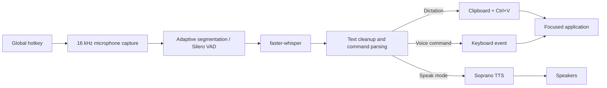

<div align="center">

# 🎙️ Voice Vibe

### Speak anywhere. Type nowhere.

**Private, local-first voice dictation for Windows — with global hotkeys, wake-word sessions, voice commands, and optional text-to-speech.**

[](https://www.python.org/)
[](#requirements)
[](https://github.com/SYSTRAN/faster-whisper)
[](#privacy)
[](https://github.com/Masqiller/Voice_Vibe)


[Quick start](#quick-start) · [How to use](#how-to-use) · [Wake-word mode](#f10--wake-word-session) · [Configuration](#configuration-reference) · [Troubleshooting](#troubleshooting)

</div>

---

Voice Vibe turns your microphone into a system-wide input method. Click any text field—an AI chat, browser, code editor, terminal, Notepad, or search box—then speak. Transcription runs locally through Whisper and the result appears at the focused cursor.

It supports three workflows:

- **F9 — one-shot dictation:** tap once to record, tap again to transcribe and paste.
- **F10 — wake-word session:** leave the session armed, say **“hey computer”**, dictate, then say **“enter”** to paste, submit, and re-arm.
- **Shift+F9 — speech output:** record speech, transcribe it, and read the result aloud with Soprano TTS.

> [!IMPORTANT]
> F10 must keep the microphone open locally to hear the wake phrase. While armed, background utterances may be segmented and transcribed locally for wake-word detection, but they are **not typed, saved, or sent to a cloud service**.

## Why Voice Vibe?

- ⚡ Fast local transcription with `large-v3-turbo` and CTranslate2
- 🔒 No API key, cloud transcription, account, telemetry, or subscription
- 🎯 Inserts into the currently focused field instead of a dedicated editor
- 🗣️ Wake phrase, sleep phrase, submit commands, and hands-free sessions
- 🧠 Exact + safe fuzzy wake matching, with Whisper prompt biasing
- ⌨️ Configurable global hotkeys and arbitrary key-combination voice commands
- 📋 Unicode-safe clipboard paste with automatic clipboard restoration
- 🔊 Optional local Soprano text-to-speech
- 🎨 Tray states and audible feedback for every mode
- 🛠️ Built-in microphone, environment, pipeline, and wake-phrase diagnostics
## Contents

- [Quick start](#quick-start)
- [How to use](#how-to-use)
- [F9 — one-shot dictation](#f9--one-shot-dictation)
- [F10 — wake-word session](#f10--wake-word-session)
- [Shift+F9 — text-to-speech](#shiftf9--text-to-speech)
- [Voice commands](#voice-commands)
- [How it works](#how-it-works)
- [Configuration reference](#configuration-reference)
- [Command-line reference](#command-line-reference)
- [Testing and diagnostics](#testing-and-diagnostics)
- [Troubleshooting](#troubleshooting)
- [Privacy](#privacy)
- [Limitations](#limitations)
- [Project structure](#project-structure)

## Quick start

### Requirements

| Requirement | Details |
| --- | --- |
| Operating system | Windows 10/11 (current implementation is Windows-focused) |
| Python | 3.10, 3.11, or 3.12; Python 3.11 is recommended |
| Package manager | [`uv`](https://docs.astral.sh/uv/) recommended |
| Microphone | Any Windows input device visible to PortAudio |
| GPU | Optional NVIDIA GPU; CPU mode is supported |
| Disk | Model cache plus dependencies; optional TTS adds several GB |

### 1. Clone and enter the repository

```powershell
git clone https://github.com/Masqiller/Voice_Vibe.git
Set-Location Voice_Vibe
```

### 2. Create the environment

```powershell
uv venv --python 3.11
```

### 3. Install

**NVIDIA GPU (recommended):**

```powershell
uv pip install -e ".[cuda]"
```

**CPU only:**

```powershell
uv pip install -e .
```

**GPU dictation + optional Soprano TTS:**

```powershell
uv pip install -e ".[cuda,tts]"
```

> [!NOTE]
> The first run downloads `large-v3-turbo` from Hugging Face. Once cached, transcription runs locally and startup takes only a few seconds.

### 4. Verify and launch

```powershell
.\run.bat --check
.\run.bat
```

A healthy check reports a microphone, `clipboard ok`, and—when using NVIDIA—a non-zero CUDA device count.

## How to use

| Shortcut | Mode | What it does |
| --- | --- | --- |
| `F9` | One-shot dictation | Tap to record, tap again to transcribe and insert |
| `F10` | Wake-word session | Tap once to arm; say “hey computer” before each request |
| `Shift+F9` | Speak aloud | Tap to record, tap again to read the transcript via Soprano |
| `Ctrl+Shift+F12` | Quit | Stops Voice Vibe; Ctrl+C in its console also works |

Always click the destination field first. Voice Vibe never steals focus: text goes to whichever window owns the keyboard focus when insertion occurs.

### Status feedback

| State | Tray colour | Meaning |
| --- | --- | --- |
| Idle | Grey | Ready; no active recording/session |
| Recording | Red | F9 or Shift+F9 is capturing audio |
| Armed | Slate | F10 is listening for the wake phrase; nothing is typed |
| Dictating | Blue | Wake phrase accepted; speech can be inserted |
| Transcribing | Amber | Audio is being decoded/processed |

Beeps reinforce the state changes: start, success, error, session open/close, wake, and re-arm each have distinct cues.
## F9 — one-shot dictation

The simplest workflow:

```text
1. Click a text field
2. Tap F9                 → recording begins
3. Speak naturally
4. Tap F9 again           → recording stops
5. Whisper transcribes    → text is pasted at the cursor
```

Example:

```text
You say:   Refactor the authentication middleware and add tests
Inserted:  Refactor the authentication middleware and add tests 
```

Recordings shorter than `audio.min_duration` are ignored, preventing accidental F9 taps from producing text.

## F10 — wake-word session

F10 is designed for hands-free conversations with AI tools.

```text
Tap F10
  └─ ARMED: background speech is ignored
       └─ “Hey computer”
            └─ DICTATING
                 └─ “Explain this function, enter”
                      ├─ inserts “Explain this function”
                      ├─ presses Enter
                      └─ returns to ARMED
Tap F10 again to close the session
```

You can wake and dictate in one sentence:

```text
“Hey computer, create a responsive login page, enter”
```

Or wake first, then speak across multiple segmented utterances:

```text
“Hey computer”
“Create a Python API”
“Use FastAPI and SQLite, enter”
```

The first two pieces are inserted as dictation arrives; the final `enter` submits and returns the session to armed mode.

### Wake phrases

Defaults:

```toml
phrases = ["hey computer", "okay computer", "ok computer"]
```

Two common words are more reliable than a short uncommon word. For example, Whisper may hear `arise` as “a rise,” “arrives,” or “Iris.” The default phrases provide more linguistic context.

Wake detection includes:

1. Exact case-insensitive word matching
2. Safe word-aligned fuzzy matching (`fuzzy = 0.82`)
3. Whisper `initial_prompt` biasing toward configured phrases
4. Support for split words and small transcription errors

It deliberately does **not** let a partial phrase match. Saying “my computer crashed” does not match “hey computer.”

### Test your own phrase

```powershell
.\run.bat --wake-test
.\run.bat --wake-test --wake "hey jarvis"
.\run.bat --wake-test --wake "start dictation" --rounds 8
```

The test records several attempts, reports exactly what Whisper heard, calculates the match rate, and suggests aliases when necessary.

Suggested phrases:

- `hey computer`
- `okay computer`
- `hey jarvis`
- `computer listen`
- `start dictation`
- `wake up`

### Sleep and safety

While dictating, say one of these to abort without submitting:

- `never mind`
- `nevermind`
- `go to sleep`
- `cancel that`

After `wake.active_timeout` seconds of inactivity, Voice Vibe automatically re-arms. This prevents a forgotten active dictation from typing a later room conversation.

## Shift+F9 — text-to-speech

With the optional `tts` dependencies installed:

```text
Tap Shift+F9 → speak → tap Shift+F9 → Whisper text → Soprano audio
```

Nothing is inserted into the focused field. Soprano reads the transcript through the default speakers.

Install TTS support:

```powershell
uv pip install -e ".[cuda,tts]"
```

Test it directly:

```powershell
.\run.bat --say "Voice Vibe is ready"
```

Soprano is English-only and does not clone your voice. It uses its own generated voice. The first use downloads and loads its model; set `speech.preload = true` to pay that startup cost when Voice Vibe launches instead.
## Voice commands

A command is recognized only at the **end** of a transcript. The command phrase is removed, then the configured key combination is pressed.

| Spoken phrase | Inserted text | Keyboard action |
| --- | --- | --- |
| `fix the login bug enter` | `fix the login bug` | Enter |
| `enter` | nothing | Enter |
| `looks good send it` | `looks good` | Enter |
| `retry enter enter` | `retry` | Enter twice |

Default commands:

```toml
[[commands]]
say = "enter"
keys = "enter"

[[commands]]
say = "send it"
keys = "enter"

[[commands]]
say = "submit"
keys = "enter"
```

Add arbitrary key combinations:

```toml
[[commands]]
say = "send message"
keys = "ctrl+enter"

[[commands]]
say = "next field"
keys = "tab"
ends_dictation = false

[[commands]]
say = "close this"
keys = "esc"
```

Supported keys include letters, digits, `enter`, `tab`, `esc`, `space`, `backspace`, `delete`, arrows, `home`, `end`, `page_up`, `page_down`, F1–F12, and modifier combinations using `ctrl`, `shift`, `alt`, or `win`.

Matching respects boundaries. `center`, `recenter`, `epicenter`, and `re-enter` do not trigger the `enter` command. “What does the enter key do?” also remains normal text because `enter` is not the final phrase.

## How it works



### One-shot pipeline

```text
pynput global hotkey
  → sounddevice float32 mono capture
  → faster-whisper / CTranslate2
  → Silero VAD filtering
  → replacements + formatting
  → clipboard save
  → copy transcript
  → simulated Ctrl+V
  → clipboard restore
```

### Continuous session pipeline

```text
continuous 30 ms audio blocks
  → adaptive room-noise estimate
  → speech-onset detection + 350 ms pre-roll
  → pause-based utterance segmentation
  → queued local Whisper transcription
  → ARMED: wake matching only
  → DICTATING: insert text / fire commands
  → submit command: return to ARMED
```

The adaptive segmenter updates its noise floor only from quiet blocks. Speech cannot ratchet the threshold upward. Minimum duration is measured on voiced blocks rather than pre-roll or trailing silence, which filters keyboard clicks and coughs without clipping first syllables.

### Why clipboard paste?

Pasting is faster than synthesizing every character and preserves Unicode such as smart quotes, em dashes, emoji, and non-Latin scripts. Voice Vibe saves the previous clipboard text, pastes the transcript, waits briefly, and restores the original clipboard.

Set `output.mode = "type"` for an application that refuses programmatic paste.
## Configuration reference

Voice Vibe reads [`config.toml`](config.toml) at startup. Restart after changing it.

### `[hotkeys]`

| Key | Default | Description |
| --- | --- | --- |
| `dictate` | `f9` | Tap-to-toggle one-shot dictation |
| `dictate_hold` | empty | Optional hold-to-record binding |
| `session` | `f10` | Open/close the persistent wake-word session |
| `speak` | `shift+f9` | Tap-to-toggle TTS capture |
| `speak_hold` | empty | Optional hold-to-record TTS binding |
| `quit` | `ctrl+shift+f12` | Quit Voice Vibe |

Hotkey syntax is lowercase tokens separated by `+`, for example `ctrl+alt+d`, `shift+f9`, or `alt_gr`. Left/right modifier variants normalize to the same token. When bindings overlap, the most specific combination wins, so `Shift+F9` never also fires plain `F9`.

### `[model]`

| Key | Default | Description |
| --- | --- | --- |
| `name` | `large-v3-turbo` | Whisper model or compatible CTranslate2 model name |
| `device` | `auto` | `auto`, `cuda`, or `cpu` |
| `compute_type` | `auto` | GPU defaults to `float16`; CPU defaults to `int8` |
| `language` | `en` | ISO-639-1 code, or `auto` for detection |
| `beam_size` | `1` | Decoder beam width; larger may improve accuracy but adds latency |
| `vad_filter` | `true` | Apply Silero VAD before decoding |
| `initial_prompt` | empty | Bias technical vocabulary and spelling |

Recommended models:

| Hardware | Model | Notes |
| --- | --- | --- |
| NVIDIA GPU with ~8 GB VRAM | `large-v3-turbo` | Best default balance |
| CPU / lower memory | `small` or `base` | Faster startup and lower memory |
| English throughput | `distil-large-v3` | English-oriented distilled model |
| Maximum multilingual accuracy | `large-v3` | Heavier and slower |

### `[audio]`

| Key | Default | Description |
| --- | --- | --- |
| `sample_rate` | `16000` | Whisper-native microphone sample rate |
| `input_device` | empty | System default; use a listed device index/name to override |
| `min_duration` | `0.25` | Ignore shorter one-shot recordings |
| `max_duration` | `300.0` | Hard cap for one-shot capture |

List devices:

```powershell
.\run.bat --list-devices
```

Then set, for example:

```toml
[audio]
input_device = "5"
```

### `[continuous]`

| Key | Default | Description |
| --- | --- | --- |
| `silence_duration` | `1.5` | Quiet time that ends an utterance |
| `speech_ratio` | `4.0` | Required level above the adaptive noise floor |
| `min_rms` | `0.006` | Absolute noise gate |
| `min_segment` | `0.3` | Minimum voiced duration; filters clicks/coughs |
| `max_segment` | `60.0` | Force a segment if speech never pauses |
| `pre_roll` | `0.35` | Audio retained before onset to preserve first syllables |

Increase `silence_duration` if Voice Vibe cuts you off while thinking. Lower it for faster responses. Raise `speech_ratio` in a noisy room; lower it if quiet speech is missed.
### `[wake]`

| Key | Default | Description |
| --- | --- | --- |
| `enabled` | `true` | Require a wake phrase in F10 mode |
| `phrases` | hey/okay/ok computer | Accepted wake phrases |
| `fuzzy` | `0.82` | Per-word near-match threshold; `0` disables |
| `bias_prompt` | `true` | Prime Whisper with the wake phrases |
| `sleep_phrases` | several | Abort active dictation without typing |
| `active_timeout` | `20.0` | Re-arm after inactivity; `0` disables |
| `log_ignored` | `true` | Show armed-state transcripts for tuning |

Set `enabled = false` to make F10 insert every segmented utterance without a wake phrase.

### `[output]`

| Key | Default | Description |
| --- | --- | --- |
| `mode` | `paste` | `paste` or simulated `type` |
| `restore_clipboard` | `true` | Restore previous clipboard text after paste |
| `type_delay` | `0.004` | Delay per character in type mode |
| `add_trailing_space` | `true` | Append a space after normal dictation |
| `strip_trailing_period` | `false` | Remove a final period |
| `lowercase` | `false` | Lowercase the transcript |
| `voice_commands` | `true` | Enable `[[commands]]` |
| `command_delay` | `0.12` | Wait between insertion and key action |

Raise `command_delay` if a target submits before the pasted text has landed.

### `[speech]`

| Key | Default | Description |
| --- | --- | --- |
| `device` | `auto` | `auto`, `cuda`, `cpu`, or `mps` |
| `backend` | `auto` | `auto`, `transformers`, or `lmdeploy` |
| `streaming` | `true` | Play chunks as they are generated |
| `temperature` | `0.4` | Delivery variation |
| `top_p` | `0.95` | Nucleus sampling threshold |
| `repetition_penalty` | `1.2` | Discourage loops |
| `cache_size_mb` | `100` | Soprano backend cache |
| `decoder_batch_size` | `1` | Decoder batch size |
| `preload` | `false` | Load Soprano when Voice Vibe starts |
| `save_dir` | empty | Optional folder for generated WAV files |

When `save_dir` is set, generation uses the non-streaming path so the audio can be written and then played.

### `[feedback]`

| Key | Default | Description |
| --- | --- | --- |
| `sounds` | `true` | Enable audible state cues |
| `tray_icon` | `true` | Show the state indicator |
| `log_transcripts` | `true` | Print recognized text in the console |

### `[[replacements]]`

Literal replacements run in order before insertion:

```toml
[[replacements]]
find = "new line"
replace = "\n"

[[replacements]]
find = "post grass"
replace = "Postgres"
```

Use this for spoken formatting and recurring recognition mistakes. Keep replacement phrases specific to avoid modifying normal sentences.

## Command-line reference

```text
run.bat [options]
```

| Option | Purpose |
| --- | --- |
| `-c, --config PATH` | Load a different TOML file |
| `--model NAME` | Override the Whisper model |
| `--device auto|cuda|cpu` | Override inference device |
| `--language CODE` | Override language; use `auto` to detect |
| `--mode paste|type` | Override insertion method |
| `--list-devices` | List microphone input devices |
| `--check` | Check Python, CUDA, microphone, and clipboard |
| `--mic-test` | Record with a live input meter |
| `--test` | Record, transcribe, and print without insertion |
| `--seconds N` | Recording duration for test modes |
| `--wake-test` | Measure wake phrase recognition |
| `--wake "PHRASE"` | Temporarily override wake phrases; comma-separated accepted |
| `--rounds N` | Attempts during `--wake-test` |
| `--say "TEXT"` | Synthesize text through Soprano and exit |
| `-v, --verbose` | Enable debug logging |

Examples:

```powershell
.\run.bat --model small --device cpu
.\run.bat --language auto --mode type
.\run.bat --wake-test --wake "start dictation" --rounds 10
.\run.bat --say "Build complete"
```
## Testing and diagnostics

Run these in order; stop at the first failure.

### 1. Environment

```powershell
.\run.bat --check
```

Expected: Python version, registered CUDA DLL directories, CTranslate2 device count, microphone name, and clipboard status.

### 2. Microphone level

```powershell
.\run.bat --mic-test
```

Speak normally for five seconds. A healthy signal moves the live dB meter and finishes with `OK microphone level looks healthy`. A meter stuck around -90 to -100 dB indicates silence.

### 3. Full STT pipeline

```powershell
.\run.bat --test
```

This records, transcribes, and prints the result without inserting anything. It isolates Whisper from focus/paste problems.

### 4. Wake recognition

```powershell
.\run.bat --wake-test
```

Use this whenever changing microphones, room acoustics, models, language, or the wake phrase.

### 5. Real insertion

1. Start `run.bat`.
2. Open Notepad.
3. Click inside the document so the caret blinks.
4. Tap F9, speak a complete sentence, and tap F9 again.
5. Confirm the console target title says Notepad and the sentence appears there.

Then test a browser input and a terminal because applications handle simulated paste differently.

## Troubleshooting

### The transcript appears in the console but not the target

Console output is a log, not the insertion destination. The target must still own keyboard focus when insertion occurs. Look for:

```text
[0.43s] -> Untitled - Notepad | your transcript
```

If the title is the terminal, the terminal had focus. Click the desired field and try again.

### Microphone is silent

1. Open **Settings → Privacy & security → Microphone**.
2. Allow desktop apps to access the microphone.
3. Open **Sound settings → Input**, select the correct device, unmute it, and raise its level.
4. Run `--list-devices` and set `audio.input_device`.
5. Confirm with `--mic-test`.

### Wake phrase is ignored

- Run `--wake-test` and inspect what Whisper actually heard.
- Prefer two common words, such as `hey computer`, over a rare isolated word.
- Add consistent mishearings to `wake.phrases`.
- Leave `wake.bias_prompt = true`.
- Lower `wake.fuzzy` only to make matching stricter; raise it cautiously.
- Speak after the session-open beep and leave a short pause afterward.

### Wake phrase fires accidentally

- Choose a less common two-word phrase.
- Raise `wake.fuzzy` toward `0.9` or set it to `0` for exact matching.
- Remove broad aliases from `wake.phrases`.
- Do not use a single everyday word such as `computer`, `start`, or `hello`.

### F10 cuts sentences too early

Raise:

```toml
[continuous]
silence_duration = 2.5
```

If speech itself is missed, lower `speech_ratio` slightly. If background noise triggers segments, raise it.

### Enter submits before the paste appears

Raise:

```toml
[output]
command_delay = 0.25
```

### Enter creates a newline instead of submitting

Configure the shortcut expected by that application:

```toml
[[commands]]
say = "send message"
keys = "ctrl+enter"
```

### Paste does not work in an elevated application

Windows prevents a normal process from injecting input into an administrator-elevated application. Run Voice Vibe at the same privilege level, or avoid elevating the target.

### CUDA is unavailable

Run `--check`. Voice Vibe registers pip-installed cuBLAS and cuDNN DLL paths before importing CTranslate2. If CUDA still reports zero devices, update the NVIDIA driver or set `model.device = "cpu"`.

### Soprano is slow on first use

The model is loaded lazily. Set `speech.preload = true` to load it during startup. Windows may install a CPU-only PyTorch build for Soprano; CPU streaming remains supported and leaves GPU memory available to Whisper.
## Privacy

Voice Vibe is local-first:

- Microphone audio is captured in memory.
- Audio is discarded after transcription.
- Transcription runs through a local faster-whisper model.
- Wake matching, replacements, and command parsing run locally.
- No account, API key, telemetry, or cloud transcription is used.
- Transcripts are printed only to the local console unless logging is disabled.
- Soprano synthesis runs locally when installed.

Network access is required initially to install packages and download model files from their upstream hosts. Cached models can subsequently run offline.

> [!WARNING]
> `log_transcripts = true` prints recognized content in the terminal. Disable it when dictating sensitive information or when terminal history is retained.

### F10 privacy detail

Software cannot recognize “hey computer” without listening for it. In armed F10 mode, the microphone remains open and the local segmenter identifies utterances. Whisper may locally transcribe those utterances to decide whether they contain the wake phrase. Non-matching text is discarded by the application and never inserted. Set `wake.log_ignored = false` to avoid printing ignored text in the console.

## Performance

Observed during development on an NVIDIA RTX 4060 Laptop GPU (8 GB):

- `large-v3-turbo` model startup from cache: roughly 4–6 seconds
- 6.7 seconds of speech transcribed in roughly 0.34 seconds
- Short prompt transcription commonly below one second
- Soprano CPU streaming began audio in roughly 0.3–0.5 seconds after model load

These are development-machine observations, not guaranteed benchmarks. Audio length, model, beam size, device, drivers, and background workload affect latency.

## Limitations

- Windows is the tested target. Some dependencies are cross-platform, but hotkeys, DLL registration, sounds, and input behavior are Windows-oriented.
- Global hotkeys are not suppressed; F9/F10 may still reach the focused application.
- Wake detection uses Whisper rather than a dedicated low-power wake-word model, so armed utterances incur local transcription work.
- Wake matching is text-based; recognition quality still depends on the microphone, accent, room, and chosen phrase.
- Text is inserted into the field focused at insertion time. Switching windows while a segment transcribes changes the destination.
- Clipboard restoration currently restores clipboard text, not every possible rich clipboard format.
- Elevated applications may reject input from a non-elevated Voice Vibe process.
- Soprano is English-only, cannot clone the speaker’s voice, and may mispronounce uncommon technical terms.
- Simultaneous F9/Shift+F9 recording is blocked while F10 session mode owns the microphone.

## Project structure

```text
Voice_Vibe/
├── assets/
│   └── voice-vibe-demo.gif      # animated README walkthrough
├── src/voicevibe/
│   ├── __main__.py              # CLI and diagnostics
│   ├── app.py                   # state machine and orchestration
│   ├── audio.py                 # one-shot + segmented microphone capture
│   ├── config.py                # TOML defaults and loading
│   ├── cuda_setup.py            # Windows NVIDIA DLL registration
│   ├── feedback.py              # tray icon and audible state cues
│   ├── hotkey.py                # global bindings and overlap resolution
│   ├── inserter.py              # paste/type output and voice commands
│   ├── selftest.py              # microphone, pipeline, and wake tests
│   ├── speaker.py               # optional Soprano TTS integration
│   ├── transcriber.py           # faster-whisper wrapper
│   └── wake.py                  # exact/fuzzy wake phrase matcher
├── config.toml                  # user-facing configuration
├── pyproject.toml               # pinned dependencies and extras
├── run.bat                      # Windows launcher
└── README.md
```

## Development

Activate the environment and run the module directly:

```powershell
.venv\Scripts\Activate.ps1
python -m voicevibe -v
```

Compile-check the source:

```powershell
python -m compileall -q src
```

When changing wake matching, validate both intended matches and false positives. A wake matcher that accepts a phrase must also prove that ordinary sentences containing only part of that phrase remain ignored.

When changing continuous segmentation, verify:

- quiet room tone does not emit segments;
- a short click/cough is rejected;
- first syllables survive via pre-roll;
- trailing pause is not handed entirely to Whisper;
- the adaptive noise floor cannot be raised by speech itself.
## FAQ

### Does it work in ChatGPT, Kiro, VS Code, browsers, and terminals?

Yes, provided the target accepts normal clipboard paste or simulated typing. Click the target field first.

### Can it run fully offline?

Yes after dependencies and models are downloaded. Set the desired models up once while online, then cached inference is local.

### Can I use another language?

Set `model.language` to an ISO-639-1 code or `auto`. Whisper is multilingual, but the default wake phrases and Soprano TTS are English-oriented. Add wake and command phrases for your language and verify them with `--wake-test`.

### Can I keep F10 open all day?

Yes. It remains armed after every submit command. Remember that local audio capture and wake detection remain active while the session is open; tap F10 to close it completely.

### Can I use a foot pedal or macro key?

Yes, if it emits a key/chord recognized by `pynput`. Configure that chord under `[hotkeys]`.

### Why not use Windows built-in dictation?

Voice Vibe gives you local model control, configurable wake-word sessions, voice-to-key commands, optional TTS, custom replacements, diagnostics, and a hackable Python codebase.

## Contributing

Issues and pull requests are welcome at [github.com/Masqiller/Voice_Vibe](https://github.com/Masqiller/Voice_Vibe).

A useful report includes:

- Windows version and Python version
- CPU/GPU and available VRAM
- Output of `run.bat --check`
- Microphone selected by `--list-devices`
- Relevant `config.toml` sections with private data removed
- Exact transcript shown in the console
- Target application and whether it runs elevated

Please do not include private recordings, secrets, or sensitive transcript text.

## Acknowledgements

Voice Vibe builds on:

- [faster-whisper](https://github.com/SYSTRAN/faster-whisper) and [CTranslate2](https://github.com/OpenNMT/CTranslate2) for fast local transcription
- [OpenAI Whisper](https://github.com/openai/whisper) for the underlying speech-recognition model family
- [Soprano](https://github.com/ekwek1/soprano) for optional local text-to-speech
- [sounddevice](https://python-sounddevice.readthedocs.io/) for microphone capture
- [pynput](https://pynput.readthedocs.io/) for global hotkeys and input simulation
- [pystray](https://github.com/moses-palmer/pystray) for tray feedback

Inspiration and prior art include [Handy](https://github.com/cjpais/handy), [WhisperWriter](https://github.com/savbell/whisper-writer), and other local-first dictation projects.

## License

No license file is currently included. Until the repository owner chooses and adds a license, normal copyright restrictions apply. If this project is intended for public reuse and contribution, add an explicit license such as MIT, Apache-2.0, or GPL-3.0.

---

<div align="center">

**Tap. Speak. Ship.**

Built for people who would rather think out loud than type every prompt.

[⬆ Back to top](#-voice-vibe)

</div>
